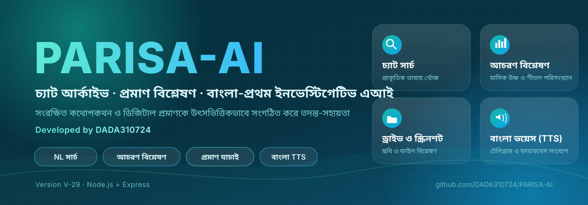

<p align="center">
  
</p>

<h1 align="center">PARISA-AI</h1>

<p align="center">
  <b>চ্যাট আর্কাইভ · প্রমাণ বিশ্লেষণ · বাংলা-প্রথম ইনভেস্টিগেটিভ এআই</b><br/>
  <i>Developed by DADA310724 · Version V-29 · Node.js + Express</i>
</p>

<p align="center">
  
  
  
  
</p>

---

## 📌 সংক্ষিপ্ত পরিচয়

PARISA-AI একটি বাংলা-প্রথম ইনভেস্টিগেটিভ এআই অ্যাপ্লিকেশন। এটি সংরক্ষিত চ্যাট আর্কাইভ, স্ক্রিনশট ও ডিজিটাল প্রমাণকে উৎসভিত্তিকভাবে (verbatim) সংগঠিত, অনুসন্ধান ও বিশ্লেষণ করে তদন্তে সহায়তা করে।

## 🎯 উদ্দেশ্য

- স্মৃতি সংরক্ষণ করা।
- বড় চ্যাট ডেটা থেকে প্রয়োজনীয় তথ্য দ্রুত খুঁজে বের করা
- প্রতিটি উত্তর যেন মূল ডেটাবেস রেকর্ড থেকে আসে, তার নিশ্চয়তা দেওয়া
- ডিজিটাল প্রমাণের স্ক্রিনশট ও ফাইল যাচাই করা
- বাংলা ভয়েসে ফলাফল শোনা (TTS)
- মাসিক আচরণগত প্রবণতা পরিসংখ্যানের মাধ্যমে বোঝা

## ⚙️ কিভাবে কাজ করে

1. **ডেটা সংগ্রহ:** চ্যাট বার্তা ও প্রমাণ (ছবি/ফাইল) ডেটাবেসে সংরক্ষিত হয়।
2. **প্রশ্ন গ্রহণ:** ব্যবহারকারী বাংলা বা ইংরেজিতে সাধারণ ভাষায় প্রশ্ন করেন।
3. **কোয়েরি রূপান্তর:** প্রশ্নটি ডেটাবেস অনুসন্ধানে রূপান্তরিত হয়।
4. **উৎসভিত্তিক উত্তর:** প্রাপ্ত আসল রেকর্ড দেখানো হয়, অনুমান নয়।
5. **বিশ্লেষণ ও আউটপুট:** প্রয়োজনে পরিসংখ্যান, চার্ট বা বাংলা ভয়েস তৈরি হয়।

## ✨ ফিচারসমূহ

| # | ফিচার | কী করে |
|---|---|---|
| 1 | **NL চ্যাট সার্চ** | প্রাকৃতিক ভাষায় চ্যাট খোঁজা; উত্তর মূল রেকর্ড থেকে |
| 2 | **আচরণ বিশ্লেষণ** | মাসভিত্তিক "উষ্ণ" ও "শীতল" পরিসংখ্যান ও প্রবণতা |
| 3 | **ড্রাইভ ও স্ক্রিনশট** | Google Drive-এর স্ক্রিনশট ও প্রমাণ সংযুক্ত ও খোঁজা |
| 4 | **ব্ল্যাক ম্যাজিক এর বিশ্লেষণ** | ব্ল্যাক ম্যাজিকের (কালো জাদু) ভয়াবহ প্রভাব সম্পর্কে বিস্তারিত বিশ্লেষণ |
| 5 | **বাংলা TTS** | উত্তর ও প্রতিবেদন বাংলা ভয়েসে শোনা |
| 6 | **Telegram ও Firebase** | Telegram বটে বার্তা গ্রহণ/উত্তর; Firebase-এ ডেটা সিঙ্ক |

## 🧩 টেক স্ট্যাক

| স্তর | প্রযুক্তি |
|---|---|
| Runtime | Node.js |
| Web Framework | Express |
| ডেটা | চ্যাট ও মেটাডেটা ডেটাবেস |
| ক্লাউড | Google Drive, Firebase |
| মেসেজিং | Telegram Bot API |
| ভয়েস | বাংলা TTS |

## 🚀 ইনস্টলেশন

```bash
git clone https://github.com/DADA310724/PARISA-AI.git
cd PARISA-AI
npm install
```

প্রজেক্ট রুটে `.env` ফাইল তৈরি করুন:

```# AI Providers (at least one required)
GEMINI_API_KEY=
GEMINI_API_KEY_2=
GEMINI_API_KEY_3=
GEMINI_API_KEY_4=
GROQ_API_KEY=
GROQ_API_KEY_2=
GROQ_API_KEY_3=
GROQ_API_KEY_4=
GROQ_API_KEY_5=
OPENROUTER_API_KEY=
OPENROUTER_API_KEY_2=
DEEPSEEK_API_KEY=
DEEPSEEK_API_KEY_2=

# Google Drive (for memory files)
GOOGLE_SERVICE_ACCOUNT_JSON=

# Firebase (for logging)
FIREBASE_DATABASE_URL=

# Telegram (for forwarding)
TELEGRAM_BOT_TOKEN=
TELEGRAM_CHAT_ID=

# Server
PORT=3000
BASE_PATH=/

```

চালু করুন:

```bash
npm start
```

অ্যাপ খুলুন: `http://localhost:3000`

## 🔐 নিরাপত্তা নোট

- সব API কী ও টোকেন `.env`-এ রাখুন, কোডে নয়।
- সংবেদনশীল প্রমাণ ডেটার জন্য অ্যাক্সেস কন্ট্রোল নিশ্চিত করুন।
- ব্যবহারকারী নিজ দেশের আইন মেনে এটি ব্যবহার করবেন।

## 🗂️ রোডম্যাপ

- [ ] আরও ভাষা সমর্থন
- [ ] উন্নত চার্ট ও ড্যাশবোর্ড
- [ ] মোবাইল-ফ্রেন্ডলি ইন্টারফেস

## 👤 নির্মাতা

**DADA310724**: PARISA-AI-এর ডেভেলপার।

---

<p align="center"><sub>© PARISA-AI · Developed by DADA310724</sub></p>
