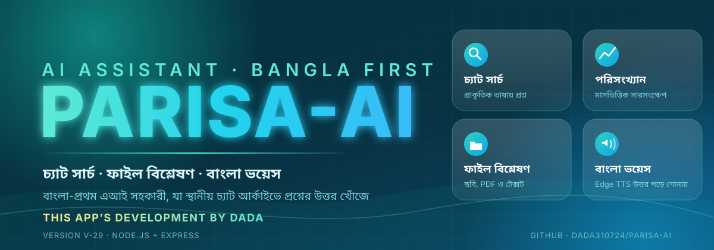

<p align="center">
  
</p>

<h1 align="center">PARISA-AI</h1>

<p align="center">
  <b>Bengali-first AI assistant for searching and summarizing a local chat archive</b><br/>
  <i>THIS APPS DEVELOPMENT BY DADA · Version V-29 · Node.js + Express</i>
</p>

---

## Overview

PARISA-AI is a Node.js and Express server that gives a Bengali-first AI assistant access to a locally stored chat archive. The assistant can search stored messages in natural language, summarize uploaded files, and read replies aloud in Bengali.

> **Privacy notice:** Chat archives contain other people's personal messages. Use this software only with data you are authorized to process, and only with the consent of the people whose messages it contains. Chat data files, API keys, and credentials are not included in this repository.

## Features

| # | Feature | What it does |
|---|---|---|
| 1 | Natural-language search | Answers questions about a local chat database, with date, platform, and file filters |
| 2 | Message statistics | Computes monthly message counts and simple keyword-based trends at startup |
| 3 | Drive file access | Lists files from configured Google Drive folders and refreshes them periodically |
| 4 | File analysis | Analyzes uploaded images, PDFs, text, audio, and video with a Gemini model |
| 5 | Bengali text-to-speech | Converts replies to Bengali speech using Microsoft Edge TTS voices |
| 6 | Notifications and logging | Sends conversation copies to a Telegram chat and logs events to Firebase |
| 7 | Provider failover | Rotates across multiple API keys and providers (Gemini, Groq, OpenRouter, DeepSeek) and skips keys that return rate-limit or authorization errors |

## How It Works

1. On startup, the server loads `chat_database.json` into memory, builds a catalog of platforms and files, and computes monthly statistics.
2. A request to `/chat` builds a search context from recent messages, queries the in-memory archive, and optionally matches Drive screenshots by date.
3. The matched records and system instructions go to the first available language model. If a key fails, the next key or provider is used.
4. The reply is cleaned, optionally forwarded to Telegram, logged to Firebase, and returned to the client.
5. `/voice` converts text to Bengali speech with retry logic. `/analyze` handles uploaded files.

## Endpoints

| Method | Path | Purpose |
|---|---|---|
| POST | `/chat` | Chat with the assistant, with optional image input |
| POST | `/analyze` | Analyze an uploaded file |
| POST | `/voice` | Return Bengali speech as MP3 |
| GET | `/drive` | List Drive files by category |
| POST | `/drive/refresh` | Force a Drive refresh |
| POST | `/log` | Write a custom event to the log |

## Tech Stack

| Layer | Technology |
|---|---|
| Runtime | Node.js (ES modules) |
| Web framework | Express, CORS |
| Storage | Local JSON file, Firebase Realtime Database |
| Cloud | Google Drive API (googleapis) |
| AI providers | Gemini, Groq, OpenRouter, DeepSeek |
| Voice | msedge-tts |
| Messaging | Telegram Bot API |

## Installation

```bash
git clone https://github.com/DADA310724/PARISA-AI.git
cd PARISA-AI
npm install
```

Create a `.env` file in the project root and do not commit it:

```env
PORT=3000
BASE_PATH=/
TELEGRAM_BOT_TOKEN=your_token
TELEGRAM_CHAT_ID=your_chat_id
FIREBASE_DATABASE_URL=your_database_url
GEMINI_API_KEYS=key1,key2
GROQ_API_KEYS=key1,key2
OPENROUTER_API_KEY=your_key
DEEPSEEK_API_KEY=your_key
```

Start the server with `npm start`, then open `http://localhost:3000`.

## Security Notes

- Keep all keys and tokens in `.env`. Never put them in source code.
- Add `.env`, `chat_database.json`, and any Google service-account JSON to `.gitignore`.
- Restrict Drive and Firebase permissions to the minimum needed.
- Review what is sent to third-party AI providers before processing sensitive data.

## Developer

**DADA**: Developer of PARISA-AI.

---

<p align="center"><sub>© PARISA-AI · THIS APPS DEVELOPMENT BY DADA</sub></p>
